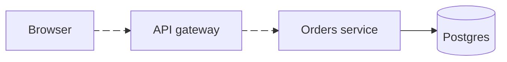

# Diagrams in Claude Lens

Claude Lens shows fenced ```mermaid code blocks as rendered diagrams. Use one when the answer is about how things connect or happen in order: a request flow, a call chain across services, a state machine, a schema, a decision tree, a timeline.

## How to draw

- Keep it small: about 4 to 15 nodes. Split a big system into two diagrams instead of one huge one.
- Put one or two plain sentences before the diagram saying what it shows, and the key takeaway after it.
- Pick the type that fits:
  - `flowchart LR` or `flowchart TD` for flows, pipelines, architecture
  - `sequenceDiagram` for calls between services over time
  - `stateDiagram-v2` for states and transitions
  - `erDiagram` for data models
  - `timeline` or `gantt` for history and plans
- Short labels. Use quotes for labels with spaces or symbols: `A["Auth service"]`.
- Real names from the code (services, functions, tables), not placeholders.

## Show movement

To show what flows where, animate the important edges. Give the edge an id, then turn on animation:



Animate the main path only, so it stands out from the rest.

## Don't

- Don't use a diagram for something a short list says just as well.
- Don't use HTML, `click` callbacks, or `%%{init}%%` theme blocks; Lens handles the theme.
- Don't repeat the whole diagram in prose afterwards.
